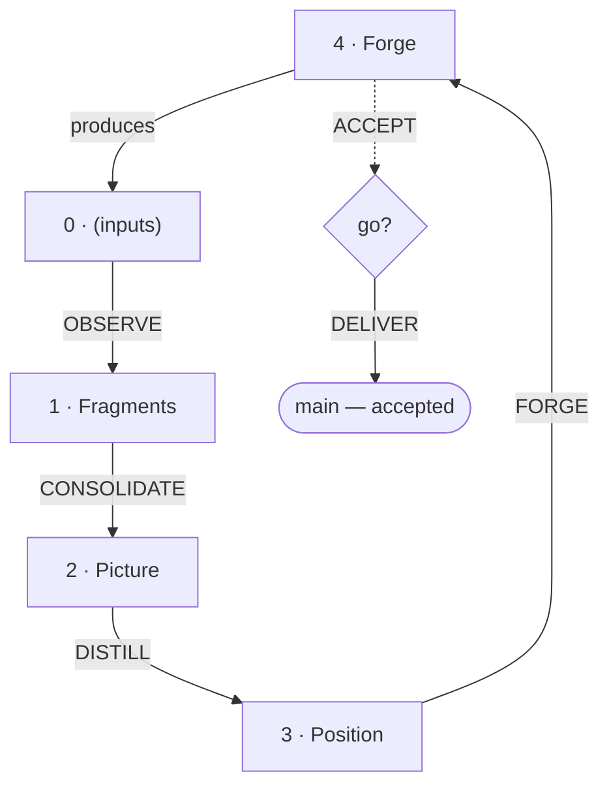

# Elasis

*The swift forge.*

A method for projects where the result is critical and the knowledge is well understood. From fragments to deliverable — one cycle, no ceremony. The simplest profile of the Kyklos family: the common trunk, without refinement modules.

The name means "driving forward" (ἔλασις).

---

## The Cycle

The Forge acts on the world and produces results. Results feed fragments. Fragments consolidate into knowledge. Knowledge frames action. Action forges.



| # | Level | Pole | Role |
|---|-------|------|------|
| 0 | *(parallel input folders)* | Experience | Raw input — lived, received, observed |
| 1 | Fragments | — | Reflect on one aspect — views with their conditions |
| 2 | Picture | Knowledge | Consolidate into patterns |
| 3 | Position | — | Frame for action (+ directives) |
| 4 | Forge | Experience | Materialise, act on the world |

Two poles: **Forge/inputs** (experience) and **Picture** (knowledge). Two interfaces: **Fragments** (between experience and knowledge) and **Position** (between knowledge and action). Two artifacts: **Knowledge** (Picture) and **Executable** (Forge).

The cycle: `4 → 0 → 1 → 2 → 3 → 4`

---

## Inside the Project

Elasis describes the inside of the folder it is given — a piece of a corpus, a project filed in a zone, or, when the project lives alone, the zone where its workspace produces. It does not name what contains it.

```
<the folder you are given>/
├── 0. References/ · 0. Result/  ← inputs, outside the sequence
├── 1. Fragments/
├── 2. Picture/
├── 3. Position/
└── 4. Forge/
    ├── CHOICES.md …   ← Forge directives
    └── <PRODUCT>/     ← the product, written by FORGE on a working branch
```

The levels lie flat, numbered as a sequence; the product lives at the Forge, the last step. The deliverable is not a folder but a state: what `main` holds of `4. Forge/<PRODUCT>/`. Level 0 holds parallel folders, all numbered 0, one per kind of input: `0. Result/` (what the forge produced in the world), `0. References/` (external sources, borrowed knowledge), `0. Communication/` (what is shared with others), `0. Dialogs/` (conversations, interviews), `0. Survey/` (structured enquiry). Create only those you need.

**Around the cycle, Genesis.** The folder explains itself — README, INTENTION — as Genesis says; what you discard goes to the excluded zones of the workspace; names and marks follow its conventions. Local gestures follow Praxis. A project that lives alone becomes a Genesis workspace and lays this sequence out in the zone where it produces.

---

## The Levels

**Input Zone (0).** Raw material, held as it came. Not a working phase but an inbox. This is where the situated lives — dated, tied to its case.

**Fragments (1).** A space of reflection on one aspect. The mind does not think a problem whole: it cuts it up and works one aspect at a time. A fragment is that aspect, and the place where one's view of it is refined — several principles, even several doctrines, one per case or competing ones set against each other. Its unit is the aspect, not the conclusion. It is a view, not a science: one follows a school.

A fragment is high-level and carries its **conditions of applicability** — *when A, then X*. That is why it has no date and tells no story: the situated case stays in level 0, grounding the fragment without appearing in it. What depends on the moment or the place belongs elsewhere — a record of what happened (level 0), a *how* (the Forge directives), a decision for our situation (Position). A local doctrine that has lost its conditions has become a Position. Fragments can emerge from any input folder or from unrecorded experience. Good fragments have minimal coupling: autonomous nodes, few edges.

**Picture (2).** Patterns consolidated from fragments — what recurs, what conflicts, what connects. It maps; it does not choose. A **Knowledge Artifact** — shareable and usable on its own.

**Position (3).** Where choices are made. Position is **situated**: it looks at our situation, recognises which conditions are ours, and decides — what we do, what we reject, what we accept as trade-off. It carries **context** as directives: choices, constraints, beliefs. As the last level before the Forge, it is also where the artefact's language is declared, when its readers are not the workshop's.

**Forge (4).** Where intent becomes an **Executable Artifact**. FORGE writes the product itself, in `4. Forge/<PRODUCT>/`, on a working branch. What is forged produces results, fed back to 0 for the next iteration.

---

## Gestures

Seven gestures, each following the Praxis anatomy (Tekton .. Praxis .. PRAXIS), in `GESTURES/` beside this document. The PLAYBOOK sequences them.

| Gesture | Transition | Nature |
|---------|-----------|--------|
| OBSERVE | 0 → Fragments | Draw from an experience a view on one aspect |
| CONSOLIDATE | Fragments → Picture | Reveal the patterns |
| DISTILL | Picture → Position | Frame for action |
| FORGE | Position → Forge | Materialise |
| ACCEPT | Forge → go/no-go | Confront with the previous deliverable and with the workshop |
| DELIVER | Forge → Deliverable | The accepted state advances; a tag marks it |
| HARVEST | (external) → Fragments | Import from another project |

The first four form the cycle. ACCEPT and DELIVER are a gate between the Forge and the Deliverable — ACCEPT is a judgment (tekhnē), DELIVER advances the accepted state (automaton). HARVEST feeds the cycle from outside. FORGE begins by prospecting what already exists, so that only the delta is created.

---

## Directives

At each level, **directives** shape judgment without being the judgment. They are UPPERCASE files inside the level's folder, typed by source and force:

| Directive | Source | Force | What it says |
|-----------|--------|-------|--------------|
| FRAME | — | Structural | "Here is the perimeter" |
| CONSTRAINTS | External | **Strong** | "You must respect this — imposed from outside" |
| CHOICES | Internal | **Strong** | "We decided this — it must be respected" |
| CONSIDERATIONS | External | **Medium** | "Here is the terrain — take it into account" |
| CONVICTIONS | Internal | **Medium** | "We believe this deeply — it influences but does not prescribe" |
| TEMPERED | Experience | **Strong** | "Practice has confirmed this" |

The strong pair must be respected; the medium pair influences without prescribing; TEMPERED has survived practice and is the strongest form. Directives survive regeneration: they are the memory of what was learned along the way. When new knowledge contradicts one, it is revisited — the cycle self-corrects by walking.

---

## Producing the Deliverable

The product has one home: `4. Forge/<PRODUCT>/`, beside the Forge directives. FORGE writes it on a working branch, never on the accepted one; `main` holds the accepted state — the deliverable — and the tag of the last DELIVER the previous one.

ACCEPT confronts the branch on two faces: the last tag, which catches regressions, and the Position, which catches omissions, since the previous deliverable cannot vouch for what it never contained. If satisfied, DELIVER advances `main` to the accepted branch and tags it; how history is shaped is the house's rule, not the method's. The PLAYBOOK carries the practice.

The deliverable carries an **`ABOUT`**: what it is about, when it serves, and — when it has neighbours — when it does not, and who takes over. What leaves the workshop arrives bare; owing nothing to your workshop is not the same as being able to introduce yourself. FORGE writes it, ACCEPT reviews it.

---

## How to Use

**Starting.** Lay the levels out in the folder you are given, and let it say why the project exists (INTENTION, per Genesis). Start with Fragments. Move to the Picture when they reveal patterns, to Position when you need to frame for action, to the Forge when you need to produce.

**Maintaining.** When reality changes, update from the bottom and let changes propagate. When Position drifts from Picture, reconcile. Capture what you learn in directives. The PLAYBOOK carries the dynamics — bridges, injection, where a change enters.

**Feedback.** If you apply this method, feed back what worked, what failed, what is missing — through the project's input channel (Genesis). The field is always right.

---

## When to Use Elasis

When the result is critical and the knowledge well understood. When the project is small — fewer than about five fragments. When speed matters more than depth of analysis. When you need a deliverable, not a treatise.

Not when the project grows past about five fragments, or the path from decision to production needs staging — that is **Anabasis**, which adds production refinement. Not when the knowledge itself must be built before deciding — that is **Organon**, which adds knowledge refinement too. All three share the trunk and its gestures; Elasis is the trunk alone, and stands without the others.

---

## Dependencies

- **Genesis** (Tekton .. Genesis .. GENESIS) — workspace design conventions, and everything around the cycle: partition, excluded zones, the files a folder explains itself with, the input channel
- **Praxis** (Tekton .. Praxis .. PRAXIS) — gesture anatomy, µ namespace, orientation
- **A version control system** — a branch for the work in progress, a reference for the accepted state, a diff between the two. Any VCS gives these three; the gate (ACCEPT, DELIVER) is defined on them

---

*Drive forward.*
